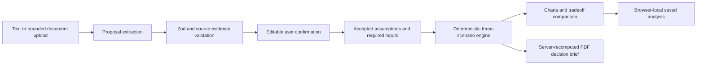

# Architecture

## Application structure

CivicDT is a Next.js App Router application written in TypeScript. It has no database or authentication dependency. React client components provide the planner workflow, charts, browser-local saved analyses, and interactive mapping. Node server routes handle bounded document ingestion, optional provider calls, and PDF export. Zod contracts join both sides to a separate deterministic analysis module.

| Layer | Responsibility |
| --- | --- |
| `src/app` | App Router pages and server API endpoints. Dashboard `/`, New Analysis `/analysis`, Scenario Comparison `/comparison`, Map `/map`, Reports `/reports`, and Methodology `/methodology`. |
| Reusable UI components | App shell, sidebar, accessible controls, workflow stages, input confirmation, charts, report presentation, and client-only Leaflet map. |
| `src/lib/schema.ts` | Project/evidence schemas, nullable proposal fields, bounded assumptions, analysis contracts, and result interfaces. |
| `src/lib/engine.ts` | Independent validated cost arithmetic, scenario construction, sensitivity, qualitative tradeoffs, limitations, and model version. |
| `src/lib/examples.ts` | Newly authored hypothetical proposal text and explicit illustrative example inputs. |
| Server extraction/provider modules | Deterministic parsing, optional server AI extraction, evidence verification, explicit mode and fallback warnings. |
| Server document/report modules | TXT/text-PDF validation and extraction; model-derived printable PDF generation. |
| Browser persistence | Current-browser saved scenarios and results. No cross-device synchronization. |
| `tests` | Unit/integration tests and Playwright workflow tests. |

The deterministic engine does not depend on React, map data, an API key, or the AI model. That separation makes the arithmetic independently testable and lets the complete demonstration run without a provider.

## Executed pipeline



Stage indicators reflect work actually being executed or completed, with an error attached to a failed stage. Confirmation is a deliberate boundary: extraction alone never means the model has sufficient inputs or accepted defaults. Ordinary proposal values are not silently filled from demo examples.

## Validation and evidence boundaries

`Proposal` contains type, location, corridor distance, crossing count, budget, changes, objectives, missing inputs, original source text, and field-linked evidence. Missing scalar values remain `null`. An evidence record includes `field`, `quote`, `start`, and `end`; the quote must match the original passage at those character offsets. Provider output is untrusted until its schema and support are checked.

`AnalysisInput` combines the proposal, validated assumptions, assumption basis (`illustrative` or `user`), and explicit illustrative acceptance. The engine validates the complete input again. It requires a project type, non-empty location, and distance or crossing count as appropriate. Unit-cost bounds, percentage bounds, integer years/crossings, and lower-cost alternative constraints are checked before calculation.

`AnalysisResult` contains the model version, generation timestamp, accepted input, quantity/unit, three scenarios, neutral summary, limitations, follow-up investigations, and actual source references. Results are computed from validated input. The PDF route recomputes the result from that input instead of trusting client-supplied output totals.

## Optional AI integration

The provider is behind a server-side abstraction. Environment configuration is:

```text
AI_PROVIDER=demo          # default; no external model call
AI_PROVIDER=openai       # optional OpenAI extraction
OPENAI_API_KEY=...        # server only, outside Git
OPENAI_MODEL=gpt-4o-mini  # optional extraction model
```

Demo mode performs deterministic text extraction and clearly labels that mode. OpenAI mode requests structured extraction, then checks source support and field validation. A missing key, provider failure, or unverifiable response returns the deterministic fallback with a visible warning. The fallback is not described as a successful AI run.

The LLM does not calculate costs or populate unobserved outcome metrics. This MVP's PDF brief is generated deterministically from the analysis; it does not call an LLM to write numerical conclusions or invent citations. Provider credentials are never exposed through `NEXT_PUBLIC_` variables.

## Documents and reports

Uploads accept UTF-8 TXT or text-based PDF, up to **2 MiB**, with no more than **30,000 extracted characters**. File type, content signature where applicable, size, decoding, extracted text, and schema bounds are checked. Empty/scanned PDFs are rejected with a readable message; the application does not provide OCR. Document extraction and provider calls happen on the server.

PDF generation uses `pdf-lib`. A paginated printable decision brief records title/location, executive summary, accepted assumptions, scenario costs/ranges, qualitative tradeoffs, limitations, follow-up investigations, model version, timestamp, and source references where they exist. All numerical results come from server-recomputed deterministic analysis. Built-in assumptions have no invented citations.

## Mapping and persistence

Leaflet loads on the client and displays attributed OpenStreetMap tiles. The map supports a project marker/illustrative corridor for visual review. Map geometry does not implicitly set or certify the cost model's quantity. Any example geometry is labeled illustrative; there is no route dataset, geocoding guarantee, network assignment, or surveyed GIS measurement in the model.

Local storage preserves scenarios for demonstration in the current browser. Persisted content is read defensively and validated before it reaches the analysis engine. It is neither a database nor a secure multi-user record system. Proposal text is sent to the application's server for extraction and, only in configured AI mode, to the external provider. Export sends validated inputs to the application's PDF route.

## Verification and deployment

Vitest checks calculation correctness, missing-data gates, schemas, comparisons/sensitivity, extraction, document errors, provider fallback, and PDF output. Playwright checks an end-to-end planner demonstration. The CI workflow installs dependencies with `npm ci`, type-checks, runs unit/integration tests, builds Next.js, installs Chromium with system dependencies, and executes browser tests. Test presence is not a claim that a particular run passed; actual results belong in the run summary/CI.

Deploy as a Node-capable Next.js application. Server extraction and PDF routes require Node execution; static export cannot provide them. Browser persistence needs no database provisioning. Demo mode needs no credentials. Production hosts should configure their normal HTTPS, port binding, request limits, and server environment settings. The MVP is designed for demonstration and bounded inputs; it does not implement municipal records retention, account permissions, or multi-user collaboration.
